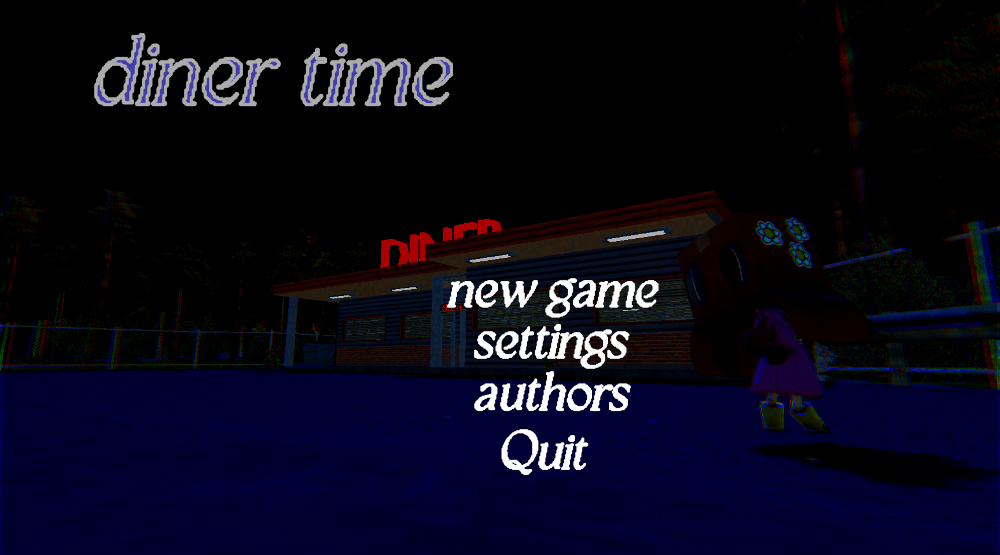
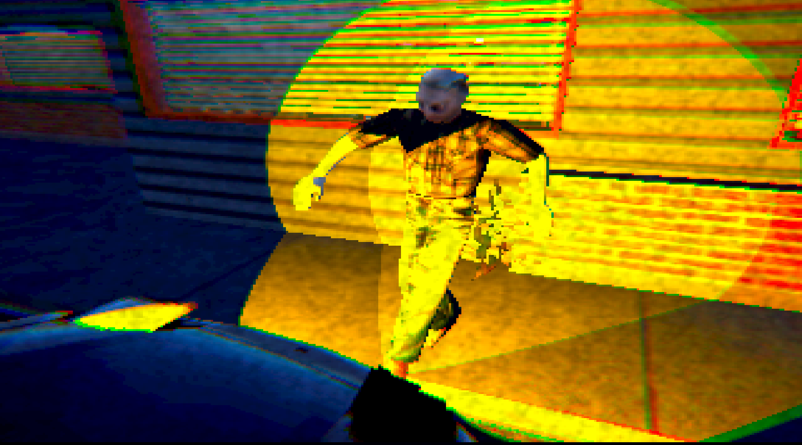
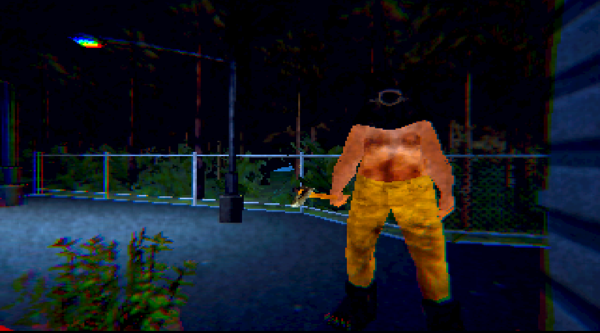

# The Diner Time

**The Diner Time** — короткий атмосферный хоррор от первого лица в стиле PS1: низкополигональная графика, пикселизация и VHS-эффекты. Вы заезжаете в придорожную закусочную, чтобы перекусить, но вскоре понимаете: это место хранит страшные секреты.

## 📖 Сюжет

Вы — путник, заглянувший в придорожную закусочную перекусить. Но стоит заглянуть в холодильник на кухне — и становится ясно, что это место скрывает нечто ужасное.

## 📸 Скриншоты

| | |
|---|---|
|  |  |
| *menu* | *y kafe* |
|  | |
| *killer* | |

## ⌨️ Управление

| Клавиша | Действие |
|---|---|
| **WASD** | Движение |
| **Мышь** | Обзор |
| **E** | Взаимодействие (диалоги, предметы, двери) |
| **G** | Бросить предмет |
| **Escape** | Пауза / выход в меню |

## 🛠️ Технологии

- **Движок:** Unity 6.6 (URP)
- **Язык:** C#
- **Стиль:** PS1 / Retro Horror (PSX Shader, Pixelation, VHS)

## 👨‍💻 Автор

Разработчик: **awxke** ([awxke](https://github.com/awxke))

---

*Сделано за сутки по фану, мб потом до ума доведу.*
